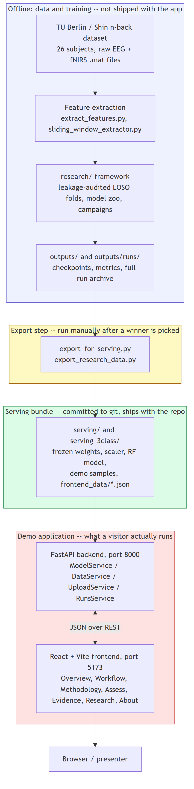
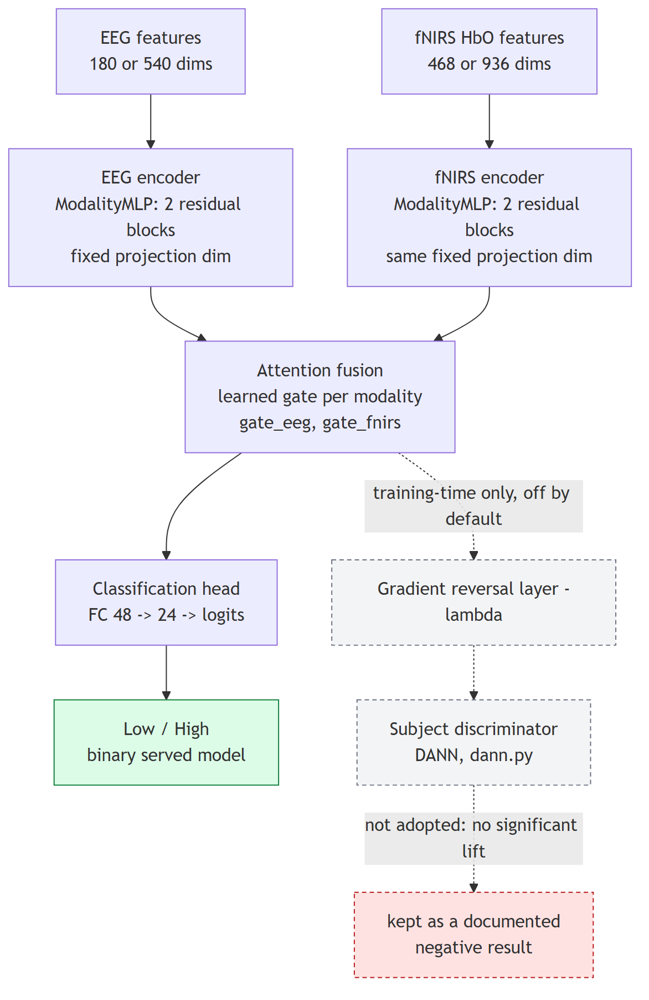
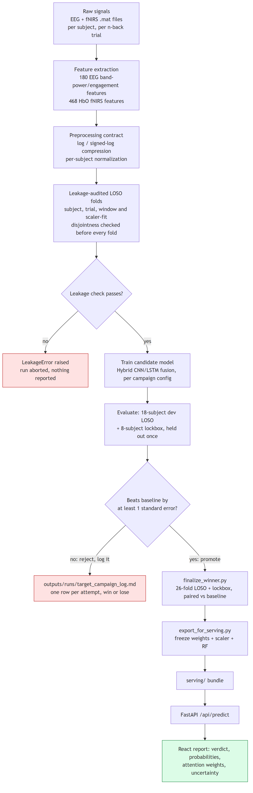
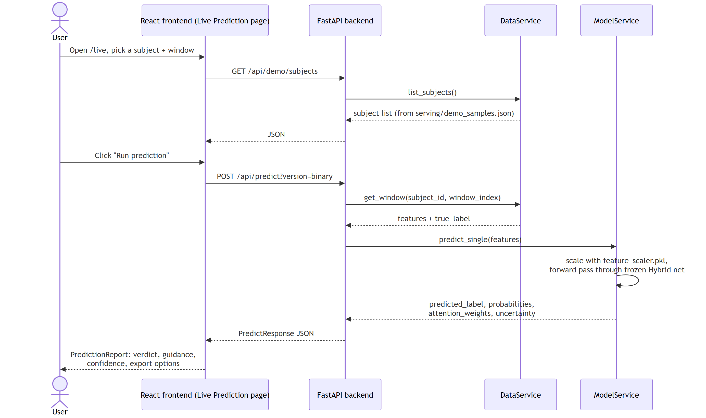

# Cognitive Load Estimation from EEG + fNIRS

**End-to-end project documentation** — generated from a direct read of the codebase, its committed reports, and a live smoke test of the backend and frontend.

*Generated 2026-08-30, from branch `updated-frontend`, commit `4c8c033`.*

---

## 1. Project Overview

This project estimates a person's **mental workload** ("cognitive load") from two kinds of brain-signal recordings taken at the same time: **EEG** (electrical activity, fast) and **fNIRS** (blood-oxygen response, slow). It fuses both signals with a small neural network and classifies each recording window as **Low** or **High** cognitive load — a possible building block for adaptive interfaces, workload-aware training systems, or safety monitoring in demanding tasks.

The data comes from the public **TU Berlin / Shin n-back dataset**: 26 subjects performing an n-back working-memory task (0-back = low load, 2-back/3-back = higher load) while EEG and fNIRS were recorded simultaneously.

What makes this project noteworthy is not just the model — it is **how honestly the evaluation is done**. The project's central finding is methodological: if you test the model on data split randomly across trials, it looks reasonably good (a "fixed split"). If you instead test it the strict way — training on some people and testing only on people the model has never seen (**leave-one-subject-out**, LOSO) — performance drops noticeably, because a fixed split lets the model quietly memorize each person's individual physiological baseline rather than learning something that generalizes. The whole project (58 tried model configurations, a leakage-auditing framework, a novel domain-adversarial experiment) is built around confronting that gap honestly rather than hiding it, and every number shown in the demo app traces back to a committed file on disk rather than being made up for the UI.

The deliverable is two things together: (1) a documented, evaluated model, and (2) a full-stack web app (FastAPI + React) that serves that model and lets a visitor explore every result, run a live prediction, and read the methodology.

---

## 2. High-Level Architecture

The project has four layers: an **offline research/training side** (not shipped — the raw dataset and full checkpoints are gitignored because they're large), an **export step** that freezes a chosen model into a small portable bundle, a **committed serving bundle** (small enough to live in git), and a **live demo application** (FastAPI backend + React frontend) that reads only from that bundle.



Key design decision worth calling out: the backend never re-derives numbers on the fly and never trains anything. Every metric, chart, and prediction the frontend shows is either (a) a forward pass through the one frozen checkpoint in `serving/`, or (b) a JSON/CSV file that a training run already wrote to `outputs/runs/`. This means the demo can run on a laptop with no GPU and no access to the 26-subject raw dataset — verified in this session by starting the backend without the `data/` directory or CUDA and confirming it serves correctly (see §7 and §8).

---

## 3. Tech Stack

| Layer | Technology | Why (inferred from code/config) |
|---|---|---|
| **Model** | PyTorch (`torch`) | Custom hybrid network — no need for a full DL framework beyond raw `nn.Module` composition |
| **Model** | scikit-learn (RandomForest, RobustScaler, StandardScaler) | Classical baseline + per-fold feature scaling with train-only fit (leakage prevention) |
| **Explainability** | SHAP | Attributes predictions to EEG vs. fNIRS feature categories |
| **Research framework** | Custom (`research/`), pandas, scipy | Leakage-audited LOSO cross-validation, paired significance testing (t-test + Wilcoxon) |
| **Backend** | FastAPI 0.139 + Uvicorn | Async-capable, auto-generates OpenAPI docs at `/docs`, minimal boilerplate for a JSON API |
| **Backend** | Pydantic (via FastAPI `schemas.py`) | Typed request/response validation |
| **Frontend** | React 19 + Vite 8 | Fast dev server, modern React (function components + hooks) |
| **Frontend** | TypeScript (partial) + JavaScript (JSX) | Codebase is mid-migration: newer files (`App.tsx`, `SessionTimeline.tsx`, pipeline components) are `.tsx`; most existing pages/components are still `.jsx` |
| **Frontend** | Tailwind CSS 4 (`@tailwindcss/vite`) | Utility-first styling, used alongside a hand-written `app.css` |
| **Frontend** | Recharts | All charts (confusion matrices, SHAP bars, ROC curves, ablation comparisons) |
| **Frontend** | Framer Motion (`motion`) | Scroll-triggered reveals, animated landing page |
| **Frontend** | jsPDF + html-to-image | Client-side export of a prediction report to PDF/PNG |
| **Testing** | Playwright | Browser smoke test (`frontend/tests/smoke.spec.ts`) that mounts every route and fails on console errors, failed requests, or horizontal overflow at mobile width |
| **Docs** | pandoc + WeasyPrint (`research/make_pdf.py`) | Regenerates the `explanation/*.pdf` write-ups from their Markdown sources |

---

## 4. Folder & File Structure

```
cognitive_load/
├── data/                    Raw + extracted feature CSVs (gitignored, large)
├── models/architectures.py  Model defs: HybridCNNLSTM, fusion modules, DANN pieces
├── config.py, data_loader.py, trainer.py    Legacy training pipeline (3-class + binary)
├── research/                Leakage-audited experiment framework (binary-model work)
│   ├── datamod.py           Preprocessing contract, LOSO folds, per-fold scalers
│   ├── leakage.py           10 leakage checks; raises LeakageError, never leaks a score
│   ├── archs.py             Model zoo for the campaigns (MLP/CNN encoders, fusion, DANN)
│   ├── train.py, metrics.py, plots.py, explain.py, campaign.py, experiment.py
│   └── verify_run.py        Recomputes metrics from a run's saved predictions.csv
├── run_campaign.py          Original 42-experiment binary-model improvement campaign
├── target_campaign.py       15 follow-up candidates on axes the 42 never touched
├── finalize_winner.py       Promotes one dev-screen winner to 26-fold LOSO + lockbox
├── ensemble_campaign.py     5-member deep-ensemble screen (--stage dev | final)
├── dann.py, dann_ablation.py   NOVEL: domain-adversarial (subject-invariant) training
├── part1_rigor.py           LOSO significance testing + ensembling (legacy 3-class)
├── classical_sweep.py       XGBoost/SVM vs Random Forest sweep (ruled out)
├── protocol_benchmark.py    Why literature's 60-90% accuracy is an easier protocol
├── export_for_serving.py    Packages the frozen model + demo data -> serving/
├── export_research_data.py  Consolidates DANN/HbR/protocol/classical -> research.json
├── outputs/                 Checkpoints, logs, figures (gitignored, large)
│   └── runs/                Per-run archive (never overwritten), 8 runs present
├── serving/                 COMMITTED demo bundle for the binary model (the one served)
├── serving_3class/          COMMITTED demo bundle for the legacy 3-class model
├── serving_936/             An older serving snapshot, not wired into the backend
├── backend/                 FastAPI app (Part 3 of the pipeline)
│   ├── main.py              All API routes
│   ├── model_service.py     Loads the frozen checkpoint + scaler, runs inference
│   ├── data_service.py      Reads precomputed JSON artifacts (metrics, SHAP, etc.)
│   ├── upload_service.py    CSV-upload preprocessing, byte-exact vs data_loader.py
│   ├── mat_extractor.py     Extracts features directly from raw .mat uploads
│   └── runs_service.py      Read-only access to outputs/runs/ for Evidence pages
├── frontend/                React + Vite demo UI (Part 4)
│   └── src/{pages,components,lib,api}/    13 routed pages, ~40 components
├── test_data/synthetic/     Synthetic CSV fixtures for testing the upload feature
├── explanation/             Long-form write-ups (Markdown + matching PDFs)
│   └── PROJECT_RECORD.md    Full record: architecture, all 42 experiments, results
├── RESULTS.md               Full results + methodology narrative (legacy pipeline)
├── RESULTS_BINARY_IMPROVEMENT.md   Machine-generated numbers, binary campaigns
├── PROJECT_STATUS.md        Headline numbers, 58-config search history, open items
├── NOVELTY_DANN.md          Write-up of the domain-adversarial contribution
└── README.md
```

A few things worth flagging about this structure for a newcomer:

- There are **three serving bundles** (`serving/`, `serving_3class/`, `serving_936/`) but the backend only wires up two of them (`serving` as `"binary"`, `serving_3class` as `"3class"` — see `backend/main.py:57`). `serving_936/` appears to be an earlier snapshot left in the tree.
- The repo root has a large number of one-off scripts from the model-development phase (`debug_eeg.py`, `diagnose_data.py`, `eda.py`, `stats_check.py`, `check_eeg.py`, …). These are historical/diagnostic tools, not part of the shipped pipeline — normal residue of an iterative ML project, but worth knowing they aren't part of the "path" a new contributor needs to follow.
- `research/` (the newer, leakage-audited binary-model framework) and the repo-root training scripts (`config.py`, `data_loader.py`, `trainer.py`, the legacy 3-class pipeline) are **two separate, non-overlapping systems** that happen to share the `models/architectures.py` model definitions. Don't conflate them.

---

## 5. Core Components — Deep Dive

### 5.1 The model (`models/architectures.py` — `HybridCNNLSTM`)

Despite the filename, this is not a CNN+LSTM by default for the served model — it's two parallel **MLP encoders** (one per modality) feeding an **attention fusion** block and a small classification head. (An LSTM path exists — `EEGSequenceEncoder` — for an alternate sliding-window/sequence feature format, but the served binary model uses the plain feature-vector MLP path.)



- **Per-modality encoders** (`ModalityMLP`): project the raw feature vector (180–540 EEG dims, or 468–936 fNIRS HbO dims) down to a small, *fixed* dimension regardless of input size — this keeps the parameter count predictable rather than exploding when fNIRS has 936 raw dims. Two residual MLP blocks (linear → batchnorm → ReLU → dropout, with a skip connection) per encoder.
- **Fusion**: four fusion strategies exist (`concat`, `attention`, `gated`, `cross_attention`); the served model uses **attention fusion** — a learned per-modality gate that lets the network weight EEG vs. fNIRS per sample. `get_attention_weights()` exposes these gate values, which is what powers the "Attention" tab in the Model Insights page.
- **Head**: two fully-connected layers down to the class logits (2 classes for the served binary model, 3 for the legacy model).
- **Served model size**: per `serving/model_config.json`, `proj_dim=96`, `enc_dim=48`, `fc_units=[48,24]` — a deliberately small network (order of ~100–200K parameters) for a dataset of only 654 samples across 26 subjects.
- **DANN hooks** (`attach_domain_head`, `forward_dann`, `GradientReversal`): dashed in the diagram because they're **inert unless explicitly attached** — the default `forward()` used by serving and by `model_service.py` never touches them. They exist purely for the `dann.py`/`dann_ablation.py` experiment described in §5.4.

### 5.2 The research framework (`research/`)

A second, additive experiment framework built specifically to improve the binary model **without letting the evaluation flatter it**. Its defining feature is that leakage checking is not an afterthought — `research/leakage.py` runs 10 checks (subject/trial/window/duplicate-row/index disjointness, scaler-fit-on-train-only, held-out-subject exclusion, NaN/Inf sanity, label sanity) **before every fold trains**, and a failure raises `LeakageError`, aborting the run outright rather than producing a number that might be flattered by a leak. `research/test_leakage.py` contains negative tests that deliberately inject each leakage type and confirm the audit actually fires — the reasoning being that an audit that never triggers proves nothing.

Every run gets a fresh, timestamped directory under `outputs/runs/` (`runctx.py`) that is never overwritten and never deleted, even on failure — so any historical result stays reproducible and inspectable. `research/verify_run.py` recomputes metrics straight from a run's saved `predictions.csv` and checks they match what was reported, closing the loop between "what the run claims" and "what the raw predictions actually show."

### 5.3 The search for a better binary model (58 configurations, 0 adopted)

Three separate, disciplined campaigns attacked the binary model, all sharing one rule: **an 18-subject development LOSO score is the only signal used to pick a candidate**; an 8-subject lockbox is touched exactly once, to confirm a promoted winner, never to select one.

| Campaign | Script | Configs tried | Outcome |
|---|---|---:|---|
| Original improvement campaign | `run_campaign.py` | 42 | None cleared the one-standard-error bar over baseline |
| Target campaign | `target_campaign.py` | 15 | None cleared on dev screen; best candidate (`D2_narrow_patience6`) was promoted anyway and **lost** on both headline protocols |
| Deep-ensemble screen | `ensemble_campaign.py` | 1 (5-member ensemble) | **First candidate to clear the dev-screen bar** — but only against an in-run baseline that itself doesn't match the documented one; full-protocol confirmation (`--stage final`) has not been run |

The D2 episode is the most instructive result in the project for a presentation: a configuration that won convincingly on the 18-fold development screen was then **re-evaluated on the full 26-fold LOSO + lockbox protocol against a freshly re-run, paired baseline** — and lost on accuracy and F1 on both. This is a direct, in-repo demonstration of why a single held-out screen is not enough evidence to ship a model change, and it's exactly the kind of finding that a fixed train/test split would have hidden.

There is also an unresolved and honestly-recorded loose end: re-running the *documented* baseline in the current environment produced a lower score (0.6304 dev-LOSO accuracy) than what `RESULTS_BINARY_IMPROVEMENT.md` reports (0.6537). The project doesn't paper over this — every later comparison is paired against the **in-run** baseline specifically to route around the mismatch, and `PROJECT_STATUS.md` lists resolving it as suggested next step #1.

### 5.4 The novel contribution: domain-adversarial (subject-invariant) training (`dann.py`, `NOVELTY_DANN.md`)

The single most consistent theme across the whole project is that **subject identity is the performance ceiling** — models generalize far worse to an unseen person than a same-subject test would suggest. Domain-Adversarial Neural Networks (DANN, Ganin & Lempitsky 2015) target that gap directly: train the fused embedding to predict cognitive load well while a second head — a subject discriminator, connected through a **gradient-reversal layer** — tries and fails to recover *which subject* a sample came from. If it works, the shared representation should keep load-relevant signal while discarding subject-identity signal.

This was implemented cleanly (see the dashed branch in the model diagram) and evaluated on the same 26-fold LOSO protocol as everything else, with paired significance testing (t-test **and** Wilcoxon) against the locked baseline. The result was a **rigorous negative finding**: DANN produced no significant improvement on the served ensemble (p≈0.86), and a lambda sweep showed task performance monotonically *degrading* as the adversarial pressure increased. Critically, the project doesn't stop at "it didn't help" — a **subject-invariance probe** (train a fresh classifier to recover subject ID from the frozen embeddings) showed the *baseline* representation was already near chance for subject recovery (9.1% vs. 5% chance), meaning there was almost no decodable subject-identity signal left for DANN to strip out in the first place. That's a mechanistic explanation for the negative result, not just a shrug — and it's presented in the app as a deliberate, well-evidenced "we tried the mainstream fix and can explain why it doesn't apply here" story rather than a hidden failure.

### 5.5 Backend (`backend/`)

A thin FastAPI service with **no training or heavy computation at request time** — everything is either a forward pass through one frozen model or a read of a precomputed JSON/CSV file.

- **`model_service.py`** — loads `model_weights.pt` + `feature_scaler.pkl` once at startup, exposes `predict_single` / `predict_batch`. Hardcodes `served_model = "hybrid_cnn_lstm"` — i.e. the Hybrid network alone, **not** the Hybrid+RF ensemble, even though `model_config.json`'s `served_model` field says `"hybrid_rf_ensemble"` (a stale metadata field from when the ensemble was still served; confirmed by reading the code directly — this is worth double-checking against `RESULTS_BINARY_IMPROVEMENT.md` before quoting either number in a presentation).
- **`data_service.py`** — reads `serving/frontend_data/*.json` (metrics, confusion matrices, SHAP, attention, diagnostics, research summary) and demo session/window data.
- **`upload_service.py`** — validates and preprocesses uploaded CSVs of already-extracted TU Berlin features; explicitly rejects a CSV missing required columns rather than guessing, and flags a degraded normalization mode when `subject_id` is absent.
- **`runs_service.py`** — read-only file-tree access into `outputs/runs/`, backing the `/runs`, `/evaluation` Evidence pages (metrics, curves, per-subject folds, SHAP, t-SNE representations, figures).
- Two model **versions** are exposed side-by-side through every relevant endpoint via a `?version=binary|3class` query parameter, letting the frontend's model switch toggle between the current 2-class model and the legacy 3-class one.

### 5.6 Frontend (`frontend/`)

A 13-route React/Vite single-page app, deliberately organized in *reading order* rather than by feature category: **Overview → Workflow → Methodology → Assess (dropdown: Live Prediction / Session Trend / Upload Data) → Evidence (dropdown: Model Insights / Evaluation / Run Archive) → Research → About**. That ordering mirrors how a visitor should actually digest the project: what it is and why, how it was built, how it's validated, then try it, then see the full evidence, then read the deep dossier.

Notable pieces:
- **`Research.jsx`** is the largest page — a long-form dossier covering the thesis, the leakage-audit design, the protocol taxonomy, the DANN contribution, and every decision gate, backed by ~15 dedicated chart components under `components/research/`.
- **`PredictionReport.jsx`** turns one raw prediction into a structured, presentable report: verdict, plain-language meaning, precautionary guidance by class, and an explicit "not a medical device" disclaimer — export via `ExportMenu.jsx` (PDF/PNG/JSON).
- **`Bios.tsx`** ships with placeholder team entries and shows a warning banner (`frontend/src/lib/team.ts`, `placeholder: true` per entry) until real names/affiliations are filled in — confirmed in the source; this is the one part of the site that genuinely cannot be derived from the repository and needs manual attention before a public presentation.
- The frontend build is a genuine TypeScript+JSX mix mid-migration, not a completed rewrite — `App.tsx` and a handful of newer files are `.tsx`, but most pages and components are still `.jsx`.

---

## 6. Data Flow / Pipeline — Raw Signal to Served Prediction

This walks through both halves: how a model gets *made* (top), and what happens on a *live prediction request* (bottom).



For a single prediction request specifically, here is the exact call path, confirmed by reading `backend/main.py` and `model_service.py`:



Two details worth knowing:
1. **CSV upload** (`POST /api/predict/upload`) runs through a *separate, byte-exact reimplementation* of the training preprocessing (`upload_service.py`), verified against `data_loader.py` with max absolute difference 0.0 — so an uploaded row and a "live demo" window get identical treatment.
2. **Per-subject normalization is a demo-mode simplification.** The model was trained with each subject normalized against that subject's own statistics. For a genuinely new person those stats don't exist yet, so the demo reuses each *known* subject's precomputed stats for the live-prediction/session pages; a CSV upload without a `subject_id` column falls back to a flagged, degraded "global" normalization. This is documented in the README, the API description, and the Methodology page — it is the single biggest caveat to state clearly in a presentation if the model is described as "working for a new person."

---

## 7. Setup & Run Instructions

Verified in this session (Windows, existing `.venv`, `.venv/Scripts/python.exe`, Python packages from `requirements.txt` already installed).

### Backend

```bash
cd backend
pip install -r requirements.txt
uvicorn main:app --reload --port 8000
```

Interactive API docs at `http://localhost:8000/docs`.

**Verified working in this session** by importing the FastAPI app directly (`import main`) rather than over HTTP (a live `uvicorn` process could not be reached from this sandboxed shell in the time available — likely an environment/networking quirk of this session, not a project problem, since the in-process import proves the app initializes and serves correctly):
- Both bundles load cleanly: `binary` (2-class, the served model) and `3class` (legacy).
- `GET /api/health` → `{"status": "ok"}`.
- `GET /api/bundles` → both bundles report `available: true`.
- `POST /api/predict` on a real demo window → returned `{"predicted_label": "High", "probabilities": {"Low": 0.418, "High": 0.582}}` — a real forward pass through the frozen checkpoint, not a stub.

One finding from this test worth flagging: the `3class` bundle's `/api/bundles` response carries a `provenance` field reading `"kind": "retrained_stand_in"` — meaning in *this* environment (where the original 3-class checkpoint and full `data/` are absent, being gitignored), the backend is serving a small retrained stand-in model (6 subjects, from `train_3class_from_demo.py`) rather than the actual checkpoint behind `RESULTS.md`'s published 3-class numbers. The backend is honest about this in its own response (it explicitly warns the numbers aren't comparable), but it's worth knowing before quoting any 3-class figure live in a demo running from a fresh checkout — the *binary* model, by contrast, loaded with no such warning, i.e. it is the real frozen checkpoint.

### Frontend

```bash
cd frontend
npm install
npm run dev
```

Open `http://localhost:5173` (use `localhost`, not `127.0.0.1` — Vite binds the hostname, which resolves to IPv6).

**Verified working in this session**: `npm run build` completed successfully (`✓ built in 1.07s`), producing a working `dist/` bundle. The only output was a non-blocking warning that the main JS chunk (~1.5 MB) exceeds Vite's 500 KB code-splitting suggestion threshold — a performance note, not a functional problem.

### Optional: smoke tests

```bash
cd frontend
npx playwright install chromium   # first time only
npm test
```

Not run in this session (would require both servers running concurrently); Playwright's Chromium browser binaries were confirmed already present on this machine from a prior install.

---

## 8. Current Status — What Works vs. What Doesn't

✅ **Fully working, verified in this session:**
- Backend FastAPI app initializes and serves both the binary and 3-class model bundles.
- A real prediction request runs end-to-end through the frozen Hybrid network and returns sane probabilities.
- Frontend builds cleanly to a production bundle with `npm run build`.
- The leakage-audit design (`research/leakage.py` + its negative tests in `test_leakage.py`) is real, specific, and runs before every fold — not just described in prose.

✅ **Fully working, verified by reading code/docs (not re-run in this session):**
- The full research pipeline (`run_campaign.py`, `target_campaign.py`, `finalize_winner.py`, `ensemble_campaign.py`) — these are long-running (minutes to hours) and were not re-executed, but their outputs (`outputs/runs/`, 8 archived runs) and narrative logs (`target_campaign_log.md`) are present and internally consistent with `PROJECT_STATUS.md`.
- The DANN novel-contribution pipeline and its documented negative result.
- CSV upload validation and strict-schema rejection logic (read, not executed against a live server this session).

⚠️ **Partially working / working with caveats:**
- The **3-class bundle**, when the real dataset/checkpoint aren't present (as in this environment), silently falls back to a small retrained stand-in and clearly flags this in its own API response — functionally "works" but returns numbers that are explicitly *not* the published research numbers.
- The frontend is a **partial TypeScript migration** — functional, but a mix of `.tsx` and `.jsx` rather than a completed rewrite, despite the latest commit message ("Frontend rebuild: TypeScript + Tailwind").
- `model_config.json`'s `served_model` field (`"hybrid_rf_ensemble"`) does not match what the code actually serves (`model_service.py` hardcodes the Hybrid alone) — cosmetically stale metadata, not a functional bug, but worth not quoting directly.
- The documented-vs-reconfirmed baseline mismatch in the binary-model campaigns (0.6537 vs. 0.6304 dev-LOSO accuracy) is open and unresolved; every downstream comparison routes around it by pairing against an in-run baseline, but the absolute reference number carries this uncertainty.

❌ **Broken, incomplete, or stubbed:**
- `/bios` (Team page) ships placeholder entries with a visible warning banner — real names/affiliations were never filled in.
- `serving_936/` exists on disk but is not wired into the backend's served bundles — appears to be an abandoned/superseded snapshot.
- The 5-member deep-ensemble candidate — the only configuration in 58 to beat its in-run dev baseline — has **not** been run through the full `--stage final` protocol (26-fold LOSO + lockbox), so it is not confirmed and not served.

🔮 **Planned but not started** (from `PROJECT_STATUS.md`'s explicit next-steps list):
1. Resolve the baseline mismatch by rerunning the documented baseline arm in the current environment.
2. Run `ensemble_campaign.py --stage final` to confirm or reject the one candidate that cleared a dev-screen bar.
3. Decide whether a 5× inference cost is acceptable for the served demo if the ensemble is confirmed.
4. Decide whether to regenerate `serving_3class/frontend_data/metrics.json` or leave the 3-class bundle frozen as a historical artifact.

---

## 9. Known Issues / Limitations

- **Cross-subject generalization is the core, unresolved scientific limitation** — not a bug, the honest headline result. LOSO accuracy for the served binary model is ~63%, well above chance (50%) but far from clinical-grade; per-subject accuracy swings from 44.9% to 80.7% depending on the individual.
- **Only 26 subjects total** — a small cohort for any claim about generalizing across a population.
- **Per-subject normalization is demo-mode only.** It cannot work as designed for a genuinely new, never-before-seen person, because it depends on precomputed per-subject statistics. This is the single most important caveat for a live audience question like "would this work on me right now?" — the honest answer is no, not without collecting baseline statistics first.
- **CSV upload only accepts already-extracted TU-Berlin-format features** (180 EEG + 468 HbO columns), not raw EEG/fNIRS signals and not another dataset or device — a separate, dataset-specific feature-extraction pipeline would be needed for that.
- **The "sustained-engagement" band shown in the Session Trend view is literature-informed context** (Yerkes–Dodson law), explicitly not a validated clinical threshold.
- **Large main JS bundle** (~1.5 MB, flagged by the Vite build) — a performance/loading-time concern for the frontend, not currently addressed with code-splitting.
- **Repo root is cluttered with one-off diagnostic/debug scripts** from the model-development phase — harmless, but raises the bar for a newcomer trying to find "the" pipeline to run.

---

## 10. Possible Next Steps / Improvements

In rough priority order, following the project's own stated priorities plus a few documentation-adjacent observations from this review:

1. **Resolve the baseline-mismatch question** (PROJECT_STATUS.md's own #1 priority) — every acceptance decision in the target/ensemble campaigns downstream depends on knowing whether 0.6537 or 0.6304 dev-LOSO accuracy is the real reference point.
2. **Finish the deep-ensemble evaluation** (`ensemble_campaign.py --stage final`) — it's the only one of 58 tried configurations to clear a development bar, and the D2 episode is direct proof that a dev-screen win can evaporate on the full protocol, so this needs a real answer either way.
3. **Fill in `/bios`** with real team information before presenting the site publicly — currently a visible placeholder warning.
4. **Decide the fate of `serving_936/`** — either wire it into the backend's bundle map with a clear label, or remove it to reduce confusion about which bundle is canonical.
5. **Reconcile `model_config.json`'s `served_model` metadata** with what `model_service.py` actually serves, so the two don't silently disagree.
6. **Consider code-splitting the frontend bundle** (dynamic `import()` for heavy chart-heavy pages like Research/Evaluation) given the 1.5 MB main-chunk warning.
7. **Finish the TypeScript migration** or explicitly stop it — the current `.tsx`/`.jsx` mix is fine functionally but is an obvious "why?" for anyone reading the source after the commit message promised a TypeScript rebuild.

---

## 11. Glossary

| Term | Meaning |
|---|---|
| **EEG** | Electroencephalography — records electrical activity at the scalp; fast (millisecond-scale) but spatially coarse. |
| **fNIRS** | Functional near-infrared spectroscopy — infers blood-oxygen changes in the brain via light absorption; slower (second-scale) but tied to actual metabolic/hemodynamic activity. HbO = oxygenated hemoglobin (the primary signal used here); HbR = deoxygenated hemoglobin. |
| **n-back task** | A working-memory task where a subject must recall an item from *n* steps back in a sequence; higher *n* = higher cognitive load. Used here to induce Low/Medium/High load states with a known ground truth. |
| **LOSO (leave-one-subject-out)** | A cross-validation protocol where the model is tested on one subject it never saw during training, repeated for every subject. The strict, honest way to measure whether a model generalizes to a new person, as opposed to a random/fixed split which can leak subject identity. |
| **Lockbox** | A held-back set of subjects (8, in this project) evaluated exactly once, after a model configuration is fully frozen — never used to pick between candidates, only to confirm a final choice. |
| **Leakage** | Any way information from the test set improperly influences training (e.g., a scaler fit on all data instead of just the training fold, or the same subject appearing in both train and test). Silently inflates reported performance. |
| **DANN (Domain-Adversarial Neural Network)** | A training technique that uses a gradient-reversal layer to make a model's internal representation "forget" an unwanted signal (here, subject identity) while still learning the target task. |
| **Gradient-reversal layer (GRL)** | Passes data through unchanged on the forward pass but multiplies the gradient by a negative constant on the backward pass — the mechanism that lets DANN train an adversary and the main encoder in opposite directions simultaneously. |
| **SHAP** | A model-explainability technique that attributes a prediction to individual input features, used here to show which EEG/fNIRS feature categories drive the model's decisions. |
| **Macro F1** | The F1 score (harmonic mean of precision and recall) averaged equally across classes, regardless of class size — resistant to being fooled by a model that just predicts the majority class. |
| **One-standard-error bar** | The acceptance rule used across all improvement campaigns: a candidate is only adopted if its score beats the baseline by at least one standard error, not just by any positive margin (guards against adopting noise). |
| **Serving bundle** | The small, frozen, git-committed folder (`serving/`) containing exactly what's needed to run inference and populate the demo UI — model weights, scaler, and precomputed evaluation artifacts — without needing the raw dataset or full training outputs. |

---

## Sources consulted

`README.md`, `PROJECT_STATUS.md`, `RESULTS.md`, `RESULTS_BINARY_IMPROVEMENT.md`, `NOVELTY_DANN.md`, `explanation/PROJECT_RECORD.md` (index only), `backend/main.py`, `backend/model_service.py`, `models/architectures.py`, `research/leakage.py`, `serving/model_config.json`, `frontend/src/App.tsx`, `frontend/package.json`, `backend/requirements.txt`, `requirements.txt`, `frontend/src/lib/team.ts`, git log, and a live in-process import/build test of both the backend and frontend performed in this session.
